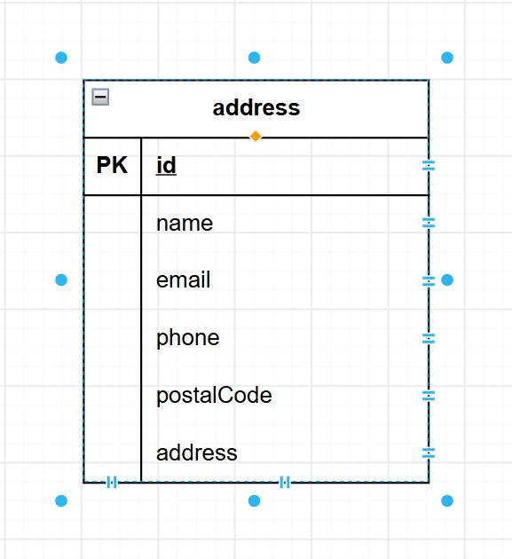

# AddressBook System
## 概要
Spring Bootを使用して開発した住所録管理システムです。
一覧・検索・登録・編集・削除・CSV取込の各機能があります。
本システムはSpring Boot、Spring Data JPA、Thymeleaf、PostgreSQLを利用して構築し、Railwayにデプロイしています。

## 本番環境
URL:https://addressbooksystem-production.up.railway.app/

## 試用技術
### バックエンド
- Java21
- Spring Boot
- Spring Data JPA
- Hibernate

### フロントエンド
- Thymeleaf
- TailwindCSS

### データベース
- PostgreSQL

### インフラ
- Railway
- Maven
- Git
- Github

## 主な機能
### 一覧表示
登録済住所情報を一覧表示します。

### キーワード検索
氏名を対象とした部分一致検索が可能です。

### 新規登録
住所情報を新規登録できます。

### 詳細表示
登録済住所情報の詳細を表示します。

### 編集
登録済住所情報を更新できます。

### 削除
登録済住所情報を削除できます。

### CSVインポート
CSVファイルから住所情報を一括登録出来ます。

## CSVフォーマット
- name
- email
- phone
- postalCode
- address

## 画面一覧
- トップ画面
- 一覧画面
- 新規登録画面
- 詳細画面
- 編集画面
- 削除画面
- CSV取込画面

## ER図

